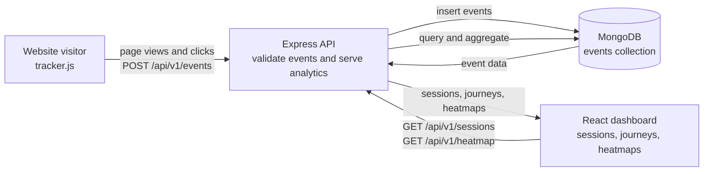

# Pathlight - simple user analytics

Pathlight tracks what visitors do on a web page (page views and clicks), stores the
events in MongoDB, and shows them in a dashboard with a **sessions / user-journey view**
and a **click heatmap**.

Built for the CausalFunnel Full Stack Engineer assignment. Product requirements are in
[`docs/PRD.md`](docs/PRD.md).

## Tech stack

| Layer     | Technology                                              |
| --------- | ------------------------------------------------------- |
| Tracker   | Vanilla JavaScript (ES5, no dependencies), `sendBeacon` |
| Backend   | Node.js, Express 4, Mongoose                            |
| Database  | MongoDB (MongoDB Atlas in production)                   |
| Dashboard | React 18, React Router 6, Vite, plain CSS, HTML canvas  |
| Hosting   | Backend on Render, dashboard on Vercel, MongoDB Atlas   |

## How it works



## Project structure

```
pathlight/
├── backend/
│   ├── public/
│   │   ├── tracker.js            # the script customers embed
│   │   └── demo/                 # 3-page fake store used to test tracking
│   ├── scripts/seed.js           # generates sample sessions
│   └── src/
│       ├── index.js              # entry: env -> DB -> listen
│       ├── app.js                # express app: middleware, routes, static files
│       ├── constants.js          # event types and limits
│       ├── db/index.js           # MongoDB connection
│       ├── models/               # Mongoose schema (event.model.js)
│       ├── validators/           # input validation for incoming events
│       ├── controllers/          # request logic (events, sessions, heatmap)
│       ├── routes/               # URL -> controller mapping
│       ├── middlewares/          # error handling
│       └── utils/                # ApiError, ApiResponse, asyncHandler, helpers
├── frontend/
│   ├── vercel.json               # SPA rewrite for Vercel
│   └── src/
│       ├── main.jsx, App.jsx     # bootstrap + routes
│       ├── api/                  # fetch wrapper + one function per endpoint
│       ├── hooks/useApi.js       # loading / error / data handling
│       ├── pages/                # SessionsPage, HeatmapPage
│       ├── components/           # list, journey, heatmap canvas, states...
│       ├── utils/                # formatting + heatmap maths
│       └── styles/index.css
├── docs/PRD.md
├── render.yaml                   # Render blueprint (backend)
└── package.json                  # root scripts
```

## Setup (local)

**Prerequisites:** Node.js 18+, and either a local MongoDB or a free MongoDB Atlas cluster.

```bash
# 1. install both apps
npm run install:all

# 2. configure the backend
cp backend/.env.example backend/.env
#    edit backend/.env and set MONGODB_URI

# 3. (optional) add sample data
npm run seed

# 4. run backend (http://localhost:8000) and frontend (http://localhost:5173)
npm run dev:backend      # terminal 1
npm run dev:frontend     # terminal 2
```

Then:

1. Open <http://localhost:8000/demo/index.html>, click around, visit the other demo pages.
2. Open the dashboard at <http://localhost:5173> and look at **Sessions** and **Heatmap**.

### Adding the tracker to your own page

```html
<script src="https://YOUR-HOST/tracker.js" defer></script>
```

Optional: `data-api="https://other-host/api/v1/events"` to send events elsewhere.

## API reference

Base path: `/api/v1`. Every response looks like
`{ "statusCode": 200, "data": ..., "message": "...", "success": true }`.

| Method | Path                          | Purpose                                             |
| ------ | ----------------------------- | --------------------------------------------------- |
| POST   | `/events`                     | Store one event (or an array of up to 50)           |
| GET    | `/sessions?page=&limit=`      | Sessions with event counts, newest first, paginated |
| GET    | `/sessions/:sessionId/events` | All events of one session, oldest first             |
| GET    | `/heatmap/pages`              | Tracked pages with click / view counts              |
| GET    | `/heatmap?url=<page url>`     | Click positions for one page                        |
| GET    | `/health`                     | Liveness check                                      |

Example event:

```json
{
  "session_id": "6f1c0d5e-...",
  "event_type": "click",
  "page_url": "https://shop.example.com/cart",
  "timestamp": "2026-10-14T09:30:00.000Z",
  "x": 412,
  "y": 880,
  "page_width": 1440,
  "page_height": 2100,
  "viewport_width": 1440,
  "viewport_height": 800,
  "target": { "tag": "button", "text": "Place order" }
}
```

Try it:

```bash
curl -X POST http://localhost:8000/api/v1/events \
  -H "Content-Type: application/json" \
  -d '{"session_id":"test-1","event_type":"page_view","page_url":"http://localhost:8000/demo/index.html","timestamp":"2026-10-14T09:30:00Z"}'
```

## Deployment: backend on Render, frontend on Vercel

Deploy in this order: **Atlas -> Render -> Vercel -> back to Render** (to allow the dashboard's origin).

### 1. MongoDB Atlas

Create a free cluster and a database user. Under **Network Access** allow `0.0.0.0/0` (Render's
free tier has no fixed IP). Copy the `mongodb+srv://...` connection string.

### 2. Backend on Render

Push the repo to GitHub, then **New > Web Service** (or **Blueprint**, which reads `render.yaml`):

| Setting           | Value                           |
| ----------------- | ------------------------------- |
| Root directory    | `backend`                       |
| Build command     | `npm install`                   |
| Start command     | `npm start`                     |
| Health check path | `/api/v1/health`                |
| `MONGODB_URI`     | your Atlas string               |
| `NODE_VERSION`    | `20`                            |
| `CORS_ORIGIN`     | add in step 4 (your Vercel URL) |

Note the service URL, e.g. `https://pathlight-api.onrender.com`. It also serves
`/tracker.js` and `/demo/index.html`.

### 3. Frontend on Vercel

**Add New > Project**, import the repo, then:

| Setting             | Value                                                         |
| ------------------- | ------------------------------------------------------------- |
| Root directory      | `frontend`                                                    |
| Framework preset    | Vite                                                          |
| Build / Output      | `npm run build` / `dist` (auto-detected)                      |
| `VITE_API_BASE_URL` | `https://pathlight-api.onrender.com/api/v1` (no trailing `/`) |

`frontend/vercel.json` rewrites every path to `index.html` so refreshing `/sessions/...` works.

### 4. Allow the dashboard to call the API

On Render set `CORS_ORIGIN` to your Vercel URL (e.g. `https://pathlight.vercel.app`, no trailing
slash; separate several with commas, for instance a custom domain). Render restarts the service.

### 5. Verify

- `https://<render-url>/api/v1/health` returns OK.
- Open `https://<render-url>/demo/index.html`, click around.
- Open the Vercel URL: the session and its journey appear; the heatmap shows your clicks.

Free Render services sleep after inactivity, so the first request can take up to a minute.

## Assumptions and trade-offs

- **Split hosting.** The dashboard (static files) lives on Vercel's CDN; the API, tracker and
  demo pages live on Render. The API URL is baked into the frontend build (`VITE_API_BASE_URL`),
  and CORS is configured per route: ingestion is open to any site (the tracker runs everywhere),
  while dashboard read endpoints only accept the origins listed in `CORS_ORIGIN`. Note that CORS
  only stops other websites' browsers from reading the data; it is not authentication.
- **Sessions are derived, not stored.** Each event carries `sessionId`; the session list is an
  aggregation over events. Simple and consistent, but the aggregation reads every event, so
  at large scale you would pre-compute a `sessions` collection.
- **Session = browser storage + 30 min inactivity.** The id lives in `localStorage` (cookie
  fallback). After 30 minutes without activity a new session starts. Different browsers or
  incognito windows are different sessions; the id is not shared across subdomains.
- **Heatmap scaling.** Click x is stored with the page width and drawn as a ratio, so visitors
  with different screen widths line up. y stays in pixels. Pages that reflow heavily between
  breakpoints will look approximate.
- **Page identity ignores query and hash.** `/cart?x=1` and `/cart` are the same page.
- **Open, unauthenticated APIs.** The ingestion endpoint must be public (it is called from any
  site). The dashboard APIs have no login, because auth was outside the assignment scope.
  Before a real launch: add auth to read endpoints, rate-limit ingestion and add a site key.
- **Client time is trusted.** Event timestamps come from the visitor's clock; invalid values
  fall back to server time.
- **Heatmap cap.** At most 10,000 most recent clicks per page are returned.
- **Seed data is synthetic.** Seeded click positions only approximate the demo layout; real
  clicks line up exactly with the page preview.
- **No automated tests or bot filtering** (time-boxed); see "Next steps" in the PRD.
